# System Design in Pictures: A Visual Guide in 60+ Images

System design is easier to understand through diagrams than through long paragraphs. A single well-drawn image can explain how a request flows, how a cache works, or how services talk to each other more clearly than pages of text.

This post is a visual reference guide. It is intentionally image-heavy, with only short explanations to support each diagram. The goal is simple: to bring the most useful system design visuals together in one place, so you can revise concepts quickly without jumping between dozens of websites.

Use it as a companion for interview preparation, architecture discussions, or a quick refresher. It is not a deep-dive tutorial.

**Credits:**
Images in this guide belong to their respective owners, as shown by the watermark on each image. They are collected here for learning and reference only.

---

## Table of Contents

1. [The Big Picture](#1-the-big-picture)
2. [Foundations: Requirements, Estimation & HLD/LLD](#2-foundations-requirements-estimation--hldlld)
3. [Architecture Styles & Microservices](#3-architecture-styles--microservices)
4. [Client, DNS & the Request Lifecycle](#4-client-dns--the-request-lifecycle)
5. [API Design](#5-api-design)
6. [Edge Layer: CDN, Proxy & Reverse Proxy](#6-edge-layer-cdn-proxy--reverse-proxy)
7. [API Gateway & Rate Limiting](#7-api-gateway--rate-limiting)
8. [Load Balancing](#8-load-balancing)
9. [Real-time Communication & Frontend Servers](#9-real-time-communication--frontend-servers)
10. [Caching](#10-caching)
11. [Databases & Storage](#11-databases--storage)
12. [Messaging & Event-Driven Architecture](#12-messaging--event-driven-architecture)
13. [Distributed Systems Fundamentals](#13-distributed-systems-fundamentals)
14. [Scalability](#14-scalability)
15. [Reliability, Availability & Fault Tolerance](#15-reliability-availability--fault-tolerance)
16. [Observability & Performance Monitoring](#16-observability--performance-monitoring)
17. [Security](#17-security)
18. [Infrastructure, DevOps & Cost](#18-infrastructure-devops--cost)
19. [Worked Examples](#19-worked-examples)
20. [Quick Revision](#20-quick-revision)
21. [Corrections & Additions Log](#21-corrections--additions-log)

---

## 1. The Big Picture

### Overview


*The blueprint walks a request through every layer — client, DNS, CDN, API gateway, load balancer, frontend and backend servers, caches, databases, media pipeline and fan-out services — with the options, metrics and security notes for each. Sections 4–12 of this guide follow the same order.*


**1. Modern web system architecture flow** — the end-to-end path a request takes through a typical production system.


**2. 15 core concepts of system design** — the vocabulary checklist (scaling, load balancing, caching, sharding, replication, CAP, queues, etc.). Use it to self-test.


**3. Fantastic Four of system design** — the four quality goals every design is judged on (scalability, availability, reliability, performance).


**4. Mental models** — everyday analogies for core components (see table below).


**5. 8 common system design problems and solutions** — problem → pattern map (read-heavy → cache, write-heavy → async queue, SPOF → redundancy, large files → object storage + CDN, slow queries → indexes/sharding …). Revisit this after finishing the guide.


**Request path at a glance**

```
Client ─► DNS ─► CDN/Edge ─► API Gateway ─► Load Balancer ─► Frontend / Backend Servers
                                                              │
         ┌──────────────┬──────────────┬─────────────┬────────┴─────┬──────────────┐
         ▼              ▼              ▼             ▼              ▼              ▼
     ID Gen / Locks   Cache        Databases    Media Upload     Pub/Sub ─► Fan-out services
```

> **Note on ordering:** the blueprint places the API Gateway *before* the load balancer. Both orders exist in practice — often an external L4/L7 load balancer sits in front of a cluster of gateway nodes, and internal load balancers sit behind the gateway in front of each service.

**Mental models**

| Component | Analogy | Why it helps |
|---|---|---|
| Load balancer | Traffic controller | Spreads cars (requests) across lanes (servers) |
| Message queue | Supermarket queue | Work waits until a worker is free; absorbs spikes |
| Cache | Bookshelf next to your desk | Frequently used items kept close |
| API gateway | Restaurant reception | One entry point that directs you to the right place |
| CDN | Local warehouse | Goods stored near customers, not only at the factory |
| Database replica | Photocopy of a ledger | Many people can read; only the original is written |

---

## 2. Foundations: Requirements, Estimation & HLD/LLD

### Overview

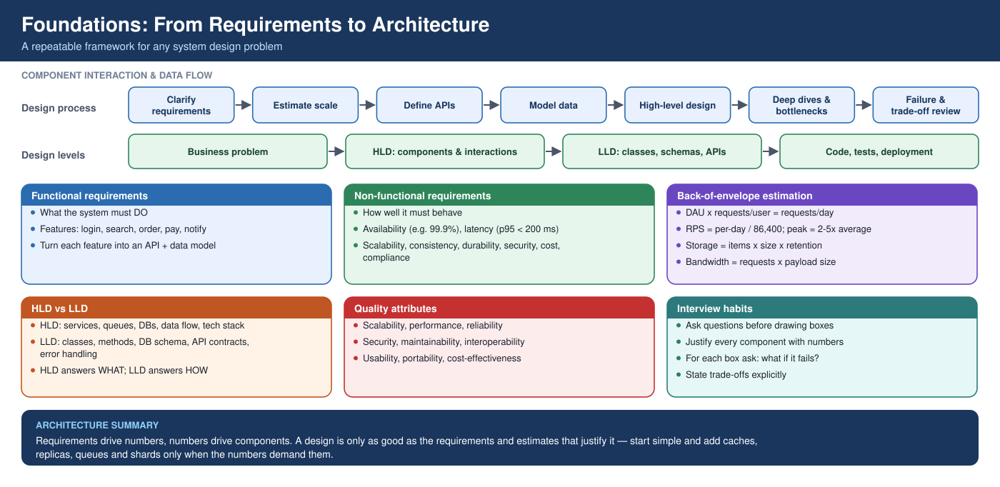


**Steps to get started with system design** — requirements → architecture → tech stack → modules → scalability → security → testing.


**System design** = defining a system's architecture, components, interfaces and data so that it meets functional and non-functional requirements while staying scalable, reliable, secure, maintainable and cost-effective.

#### HLD vs LLD

| | High-Level Design (HLD) | Low-Level Design (LLD) |
|---|---|---|
| Question | *What* components exist and how do they interact? | *How* is each component built? |
| Contents | Services, queues, databases, data flow, tech stack, trade-offs | Classes, methods, DB schema, API contracts, error handling, design patterns, SOLID |
| Artifacts | Architecture, component, deployment, data-flow diagrams | Class & sequence diagrams, pseudocode |
| Input | Requirements (SRS) | Reviewed HLD |
| Usually by | Architects, senior engineers | Developers / designers |


---

## 3. Architecture Styles & Microservices

### Overview

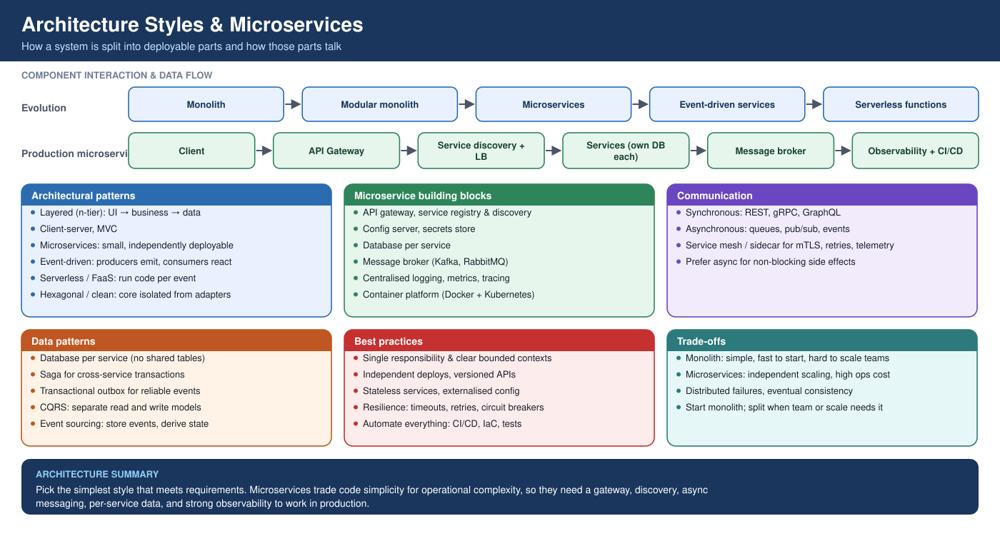


**1. 6 software architectural patterns** — layered, client-server, event-driven, microservices, MVC and similar styles, with where each fits.


**2. Components of a production microservice application** — gateway, service registry/discovery, services with their own databases, message broker, logging/monitoring, and container orchestration.


**3. 9 best practices for developing microservices** — separate data stores, independent deployment, stateless services, DDD boundaries, containers, CI/CD, observability and similar rules.


| Style | Idea | Best for | Watch out for |
|---|---|---|---|
| **Monolith** | One deployable unit | Small teams, early products | Scaling teams; one bug can take down all |
| **Modular monolith** | One deployable, strict internal modules | Most new systems | Needs discipline on boundaries |
| **Microservices** | Small services, own data, deploy independently | Large teams, uneven scaling needs | Network failures, distributed data, ops cost |
| **Event-driven** | Services react to events | Decoupled workflows, fan-out | Harder debugging, eventual consistency |
| **Serverless** | Functions triggered by events | Spiky, short workloads | Cold starts, vendor lock-in, time limits |
| **Layered (n-tier)** | UI → business → data layers | Classic enterprise apps | Can become a "big ball of mud" |

**Microservice must-haves:** API gateway · service discovery · database per service · async messaging · centralised config & secrets · distributed tracing · CI/CD · containers.

**Patterns to know:** Saga (§13), Transactional Outbox (§12), CQRS (separate read/write models), Event Sourcing (store events, rebuild state), Strangler Fig (migrate a monolith gradually), Sidecar / Service Mesh (Istio, Linkerd: mTLS, retries, telemetry outside the app), Backend-for-Frontend (one gateway per client type).

**Rule of thumb:** start with a well-structured monolith; split into services when team size, deploy frequency or scaling needs justify the operational cost.

---

## 4. Client, DNS & the Request Lifecycle

### Overview

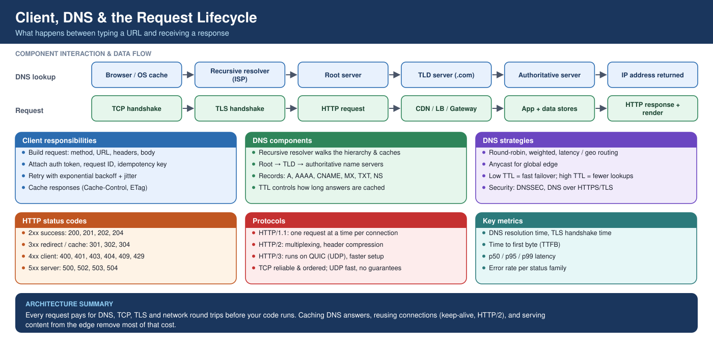


**1. What happens when you type google.com into a browser?** — URL parsing, DNS lookup, TCP/TLS handshake, HTTP request, server response and page rendering.


**2. DNS resolution flow** — recursive resolver → root → TLD → authoritative server → IP returned to the client.


 

---
## 5. API Design

### Overview

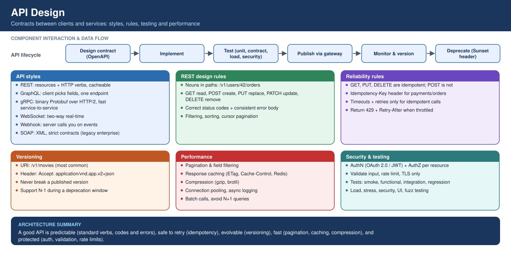


**1. The ultimate API learning roadmap** — API styles, authentication, design rules, documentation, tools, testing and gateways in one map.


**2. API concepts companion chart** — the second roadmap image from your notes, kept alongside the main roadmap.


**3. GraphQL** — a query language where the client asks for exactly the fields it needs from a single endpoint.


**4. 9 types of API testing** — smoke, functional, integration, regression, load, stress, security, UI and fuzz testing.


**5. Improve API performance** — pagination, async logging, caching, payload compression and connection pooling.


#### Choosing an API style

| Style | Format / transport | Best for | Trade-off |
|---|---|---|---|
| **REST** | JSON over HTTP | Public & CRUD APIs, cacheable reads | Over/under-fetching |
| **GraphQL** | Query language, single endpoint | Many clients needing different shapes of data | Harder caching, query cost control |
| **gRPC** | Protobuf over HTTP/2 | Fast internal service-to-service calls, streaming | Not browser-native |
| **WebSocket** | Persistent full-duplex | Chat, live updates, games | Stateful connections to scale |
| **Webhook** | HTTP callback | Notify another system of events | Receiver must be reachable & idempotent |
| **SOAP** | XML + WSDL | Legacy enterprise / banking integrations | Verbose |

#### HTTP method semantics

| Method | Purpose | Safe | Idempotent |
|---|---|---|---|
| GET | Read | Yes | Yes |
| POST | Create / action | No | **No** (add an idempotency key) |
| PUT | Replace | No | Yes |
| PATCH | Partial update | No | Not guaranteed |
| DELETE | Remove | No | Yes |

#### Pagination and versioning

| Pagination | Example | Pros | Cons |
|---|---|---|---|
| Offset / limit | `?page=5&size=20` | Simple, jump to any page | Slow on deep pages, shifts when data changes |
| Cursor / keyset | `WHERE id > :last ORDER BY id LIMIT 20` | Fast at any depth, stable | No random page jumps |

Versioning: URI (`/v1/...`, most common), header (`Accept: application/vnd.app.v2+json`), or query (`?version=2`, rarely recommended). Never break a published version; support N-1 during deprecation and announce with a `Sunset` header.

#### Idempotency — preventing duplicate payments

```
POST /payments
Idempotency-Key: 6f1e...-uuid
{ "amount": 10000, "currency": "INR" }
```

1. Client creates one UUID per *logical* operation and reuses it on retries.
2. Server atomically claims the key (unique constraint), runs the operation once and stores the response.
3. Retry with the same key → stored response is returned; concurrent duplicate → `409 Conflict`.
4. Same key with a different payload → `422`. Keys expire after a window (e.g. 24 h).

```java
@PostMapping("/payments")
public ResponseEntity<PaymentResponse> create(@RequestHeader("Idempotency-Key") String key,
                                              @RequestBody @Valid PaymentRequest req) {
    IdempotencyRecord rec = idempotencyService.claimOrGet(key, hash(req));   // INSERT with UNIQUE(key)
    if (rec.isCompleted()) return ResponseEntity.status(rec.getStatus()).body(rec.getResponse());
    if (rec.isInProgress() && !rec.isOwnedByThisCall()) return ResponseEntity.status(409).build();
    if (!rec.requestHashMatches(hash(req))) return ResponseEntity.unprocessableEntity().build();

    PaymentResponse response = paymentService.charge(req);                    // do the work once
    idempotencyService.complete(key, 201, response);
    return ResponseEntity.status(HttpStatus.CREATED).body(response);
}
```

---

## 6. Edge Layer: CDN, Proxy & Reverse Proxy

### Overview

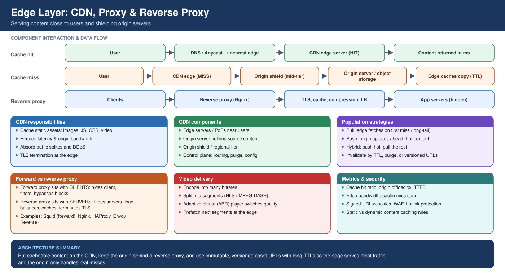


**1. CDN / edge layer** — the edge tier from your handbook: users served by nearby edge locations in front of the origin.


**2. Without a CDN** — every request travels to the origin; distant users see high latency and the origin takes all the load.


**3. With a CDN** — nearby edge servers answer most requests; the origin only handles misses.


**4. Components of a CDN** — edge servers, origin server, distribution nodes and the control plane.


**5. Proxy vs reverse proxy** — a forward proxy acts for clients; a reverse proxy acts for servers.


**6. Proxy vs reverse proxy — use cases** — the companion image showing typical uses of each (anonymity and filtering vs load balancing, caching and TLS termination).


**7. Why is Nginx so popular?** — high-performance web server built on an event-driven, non-blocking architecture; also used as reverse proxy, load balancer, cache and TLS terminator.


**CDN** = a geographically distributed network of servers that caches content close to users to cut latency and offload the origin. Used by streaming (Netflix, YouTube), e-commerce (product images) and software downloads.

| Topic | Options |
|---|---|
| **Delivery model** | Public/shared CDN (Cloudflare, Akamai, CloudFront, Azure Front Door), private CDN (Netflix Open Connect), P2P CDN (WebTorrent), multi-CDN / hybrid |
| **Population strategy** | **Pull** (edge fetches on first miss — long-tail content), **Push** (origin uploads in advance — hot, predictable content), hybrid |
| **Content** | **Static** (images, CSS, JS, video segments) — cache aggressively; **Dynamic** (personalised pages, feeds) — cache selectively or use edge compute |
| **Invalidation** | TTL expiry, purge by URL/tag, versioned file names (`app.3f9a.js`) |
| **Miss optimisation** | Origin shield, request coalescing, `stale-while-revalidate`, prefetching next video segments |

**Benefits:** speed, scalability for spikes, redundancy, lower origin bandwidth cost, security (DDoS absorption, WAF, TLS). **Costs:** service fees, cache-rule complexity, risk of serving stale or private content if rules are wrong (use signed URLs for private content).

**Forward vs reverse proxy**

| | Forward proxy | Reverse proxy |
|---|---|---|
| Sits in front of | Clients | Servers |
| Hides | Client identity | Server topology |
| Used for | Filtering, anonymity, corporate egress control | Load balancing, TLS termination, caching, compression, WAF |
| Examples | Squid, corporate proxies | Nginx, HAProxy, Envoy, Traefik |

> A load balancer and an API gateway are both specialised reverse proxies.

---

## 7. API Gateway & Rate Limiting

### Overview

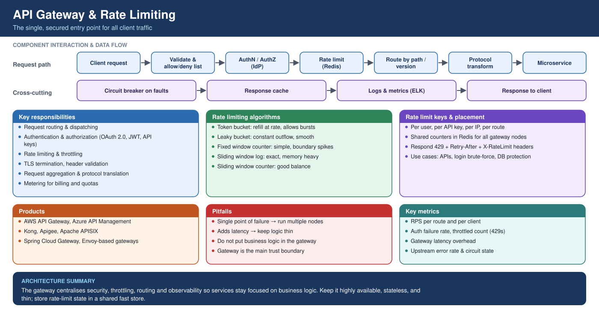


**1. API gateway controls** — the gateway layer from your handbook with its security and traffic controls.


**2. API gateway as single entry point** — clients call one endpoint; the gateway routes to backend services.


**3. E-commerce routing example** — product, order and payment requests routed to their own services.


**4. API gateway request flow (12 steps)** — read with the step list below.


1. Client sends an HTTP request to the gateway.
2. Gateway parses and validates the request.
3. Allow-list / deny-list checks.
4. Authentication and authorization with an identity provider.
5. Rate-limiting rules applied; over-limit requests are rejected (`429`).
6–7. Route lookup by path matching (service discovery).
8. Request transformed to the right protocol and sent to the microservice.
9–12. Error handling and circuit breaking, logging/monitoring (e.g. ELK), and optional response caching.

**5. How rate limiting works** — requests counted per client; within limit → forwarded, over limit → rejected.


**API gateway** = a single entry point that handles cross-cutting concerns so services focus on business logic. Optional for a monolith; essential for microservices.

| Control | What it does |
|---|---|
| Input & header validation | Reject malformed or oversized requests, enforce schema |
| Authentication / authorization | API keys, JWT, OAuth 2.0 scopes, roles |
| Rate limiting / throttling | Protect backends, ensure fairness, block brute force |
| Allow / deny lists | IPs, ranges, API keys, geographies |
| TLS termination | Decrypt HTTPS at the edge; mTLS to upstreams |
| Routing & aggregation | Path/host/version routing; combine several service calls |
| Protocol translation | e.g. REST ↔ gRPC |
| Dedup & metering | Idempotency keys; usage data for billing and quotas |
| Resilience & caching | Circuit breaking, timeouts, response caching |

**Rate-limiting algorithms**

| Algorithm | Idea | Trade-off |
|---|---|---|
| Token bucket | Tokens refill at a fixed rate; each request uses one | Allows bursts; most popular |
| Leaky bucket | Queue drains at a constant rate | Smooth output; no bursts |
| Fixed window counter | Count per fixed interval | Simple; spikes at window edges |
| Sliding window log | Keep timestamps in a rolling window | Accurate; memory heavy |
| Sliding window counter | Weighted mix of current & previous window | Good accuracy/efficiency balance |

Rate-limit keys: per user, API key, IP, route or region. Keep counters in a **shared store (Redis)** so all gateway nodes agree. Return `429 Too Many Requests` with `Retry-After`. Challenges: added latency, false positives for legitimate users, tuning limits per API, and coordination across nodes.

**Popular gateways:** AWS API Gateway, Azure API Management, Google Apigee, Kong, Apache APISIX, Spring Cloud Gateway.

---

## 8. Load Balancing

### Overview

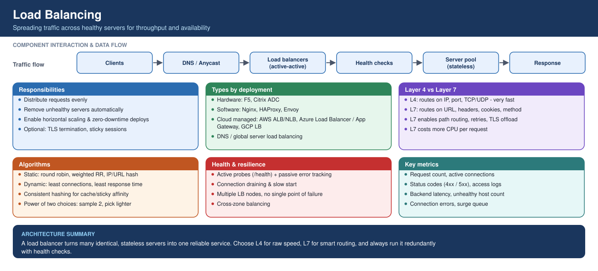


**Load balancing layer** — the load balancer tier from your handbook distributing traffic across a pool of servers.


**Load balancer** = distributes incoming traffic across multiple servers to avoid overload and improve performance, scalability and availability.

| By deployment | Examples |
|---|---|
| Hardware | F5 BIG-IP, Citrix ADC |
| Software | Nginx, HAProxy, Envoy |
| Cloud-managed | AWS ALB / NLB, Azure Load Balancer / Application Gateway, Google Cloud Load Balancing |

| | Layer 4 (transport) | Layer 7 (application) |
|---|---|---|
| Routes on | IP, port, TCP/UDP | URL path, host, headers, cookies, method |
| Speed | Faster, cheaper | More CPU, smarter |
| Extras | — | Path routing, TLS termination, sticky sessions, retries |

**Algorithms**

- *Static:* round robin, weighted round robin, IP hash / URL hash.
- *Dynamic:* least connections, least response time, resource-based.
- *Consistent hashing* for cache or session affinity; *power of two choices* (sample two servers, pick the lighter one).

**Health & topology:** active probes (`/health`) plus passive error tracking; connection draining and slow start; run LBs **active-active** (the blueprint's *multi-primary*) or active-passive with a floating IP — never a single LB node.

**Metrics:** request count, active connections, 4xx/5xx counts, access logs, backend latency, unhealthy host count.

---

## 9. Real-time Communication & Frontend Servers

### Overview

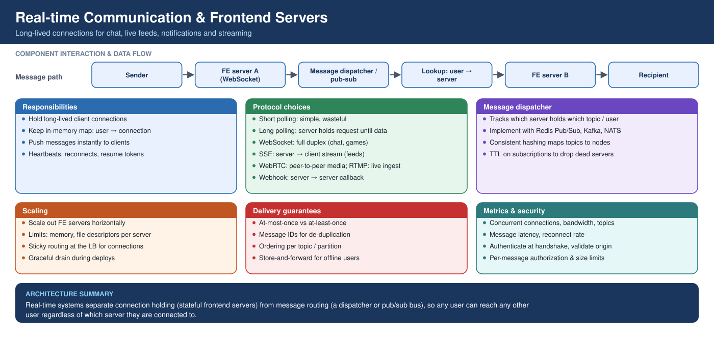


**Frontend servers & connection management** — frontend servers holding in-memory user→connection maps and forwarding messages through a dispatcher.


Frontend servers keep **long-lived connections** (WebSocket, SSE) and an in-memory map `user → connection`. Because sender and recipient may be on different servers, messages go through a **message dispatcher** that maps `server → topic/user`.

```
Sender ─► FE Server A ─► Message Dispatcher (lookup user → server) ─► FE Server B ─► Recipient
```

| Protocol | Direction | Use |
|---|---|---|
| Short polling | Client asks repeatedly | Simple, wasteful |
| Long polling | Server holds request until data | Fallback for chat |
| WebSocket | Full duplex | Chat, games, collaboration |
| SSE | Server → client | Feeds, notifications, tickers |
| WebRTC | Peer-to-peer | Video / voice calls |
| RTMP / SRT | Ingest | Live video upload to a streaming platform |
| Webhook | Server → server | Third-party event delivery |

**Dispatcher implementation:** Redis Pub/Sub, Kafka, NATS, or a custom service on a consistent-hash ring. Add TTLs on subscriptions so dead servers drop out.
**Operations:** heartbeats (ping/pong), reconnect with resume tokens, graceful drain on deploy, per-connection rate limits, backpressure for slow clients.
**Security:** authenticate at handshake, validate `Origin`, authorize per message, cap message size.
**Metrics:** concurrent connections, bandwidth and topics per server, message latency, reconnect rate.

---
## 10. Caching

### Overview

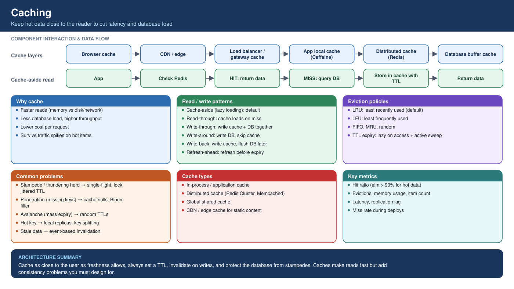


**1. Where data is cached** — cache layers from client and CDN through load balancer, application, distributed cache and database.


**2. Read & write patterns** *(generated)* — who reads/writes the cache and when the database is touched.

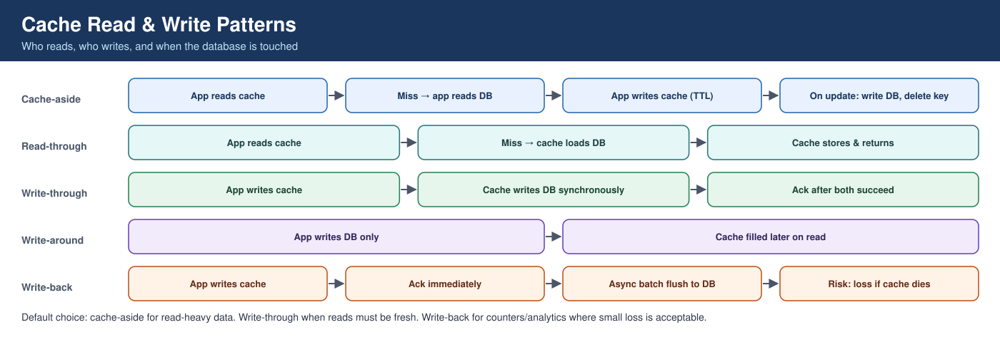


**Caching** = storing frequently used data in faster storage (usually memory) so repeat reads skip the slow source.

| Cache type | Where | Example | Note |
|---|---|---|---|
| Browser / client | User device | `Cache-Control`, `ETag` | 0 ms, but only for that user |
| CDN / edge | Near users | CloudFront, Akamai | Static and public content |
| Application (local) | In each server's memory | Caffeine, Guava | µs latency; copies can differ across servers |
| Distributed | Separate cache cluster | Redis Cluster, Memcached | Shared by all servers; consistent hashing / hash slots |
| Global (shared) | One shared instance | Single Redis | Simple; can become a bottleneck |
| Database | Inside the DB | PostgreSQL shared buffers | Automatic; tune memory |

**Uses:** web pages, database query results, API responses, sessions, rate-limit counters, leaderboards.

| Pattern | When to use |
|---|---|
| Cache-aside | Default for read-heavy data (movie catalogue) |
| Read-through | Want the cache library to load data |
| Write-through | Reads must always be fresh (user profile) |
| Write-around | Data written often but read rarely |
| Write-back | Counters, view counts, analytics — small loss acceptable |
| Refresh-ahead | Very hot keys where an expiry spike is unacceptable |

**Invalidation:** TTL (time-based), event-based (delete/update on write, pub/sub events), versioned keys. Add **jitter** to TTLs.

**Eviction:** LRU (default; hash map + doubly linked list = O(1)), LFU, FIFO, MRU (scan patterns), random. Expired keys are removed lazily on access and by a background sweep.

| Problem | Fix |
|---|---|
| Stampede / thundering herd | Single-flight (`@Cacheable(sync = true)`), Redis lock `SET NX PX`, refresh-ahead, TTL jitter, serve stale |
| Penetration (keys that don't exist) | Cache null results briefly, Bloom filter |
| Avalanche (many keys expire together) | Random TTLs, multi-level cache |
| Hot key | Local replicas, key splitting, request coalescing |
| Stale data | Event-driven invalidation, short TTLs |

**Example:** 100,000 users open the same movie. Without cache → 100,000 DB queries. With Redis at 99.9% hit ratio → ~100 DB queries.

```java
@Cacheable(cacheNames = "movies", key = "#id", sync = true)   // sync = one loader per key on a stampede
public MovieDto getMovie(long id) { return movieRepository.findById(id).map(mapper::toDto).orElseThrow(); }

@CacheEvict(cacheNames = "movies", key = "#movie.id")
public void updateMovie(Movie movie) { movieRepository.save(movie); }
```

**Pros:** faster responses, lower DB load, lower cost, better scalability. **Cons:** stale data, invalidation complexity, extra memory and infrastructure.

---

## 11. Databases & Storage

### Overview

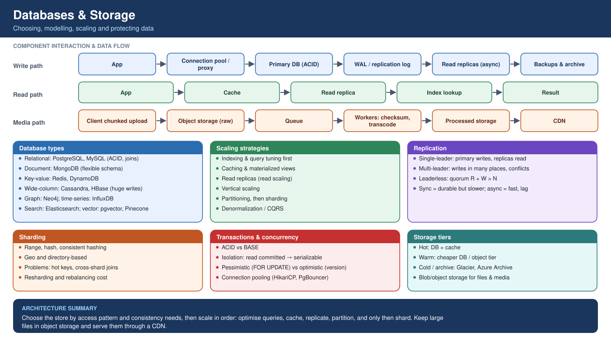


**1. How to choose the right database** — decision chart from data shape and access pattern to relational, document, key-value, wide-column, graph, time-series, search and other stores.


**2. 7 must-know strategies to scale your database** — indexing, materialized views, denormalization, vertical scaling, caching, replication and sharding.


**3. Database scaling — companion chart 1** — second database-scaling image from your notes.


**4. Database scaling — companion chart 2** — third database-scaling image from your notes.


#### Types of databases

| Type | Examples | Best for |
|---|---|---|
| Relational (RDBMS) | PostgreSQL, MySQL, SQL Server | Transactions, relationships, complex queries |
| Document | MongoDB, Couchbase | Flexible / nested schema, catalogs, CMS |
| Key-value | Redis, DynamoDB | Fast lookups by key: sessions, carts, counters |
| Wide-column | Cassandra, HBase, ScyllaDB | Massive write throughput, time-ordered data, multi-region |
| Graph | Neo4j, Amazon Neptune | Relationship traversal: social graphs, fraud |
| Time-series | InfluxDB, TimescaleDB | Metrics, IoT, monitoring |
| Search | Elasticsearch, OpenSearch | Full-text and faceted search |
| Columnar (OLAP) | ClickHouse, Redshift, BigQuery | Analytics, aggregations over billions of rows |
| Vector | pgvector, Pinecone, Milvus | Embeddings, semantic search, AI/RAG |
| Object / blob | S3, Azure Blob, GCS | Files, images, video, backups |

**Key-value stores** keep data as `key → value` for O(1)-style access by key; they scale easily but are poor at complex queries. **Blob/object storage** holds unstructured files cheaply and at huge scale; **databases** hold structured, queryable records.

| | ACID (relational) | BASE (many NoSQL) |
|---|---|---|
| Stands for | Atomicity, Consistency, Isolation, Durability | Basically Available, Soft state, Eventual consistency |
| Favours | Correctness | Availability and scale |

| | Row-oriented | Column-oriented |
|---|---|---|
| Layout | Whole rows together | Each column together |
| Best for | OLTP: single-row reads/writes | OLAP: scans, aggregates, compression |
| Examples | PostgreSQL, MySQL | ClickHouse, Redshift, Parquet files |

#### Choosing a database

| Database | Choose when | Avoid when |
|---|---|---|
| PostgreSQL / MySQL | Strong consistency, joins, transactions (users, orders, payments) | Millions of writes/sec across regions |
| MongoDB | Evolving, nested documents (catalogs, metadata) | Heavy multi-document transactions |
| DynamoDB | Known access patterns, predictable low latency at scale | Ad-hoc queries and joins |
| Cassandra | Huge writes, multi-region active-active, time-series | Joins, ad-hoc queries, strong consistency |
| Redis | Cache, sessions, counters, leaderboards, rate limits | Primary store for critical data (unless persistence designed carefully) |

#### Scaling order

```
Query tuning & indexes ─► Cache ─► Read replicas ─► Partitioning ─► Vertical scaling ─► Sharding / purpose-built stores
```

#### Replication

- **Single-leader:** primary takes writes, replicas serve reads and failover.
- **Multi-leader:** writes in several places; needs conflict resolution.
- **Leaderless (Dynamo-style):** quorum reads/writes; strong consistency when `R + W > N`.
- **Sync vs async:** sync = durable, slower; async = fast, but **replication lag** and possible loss on failover.
- Helpers: hinted handoff, Merkle trees (anti-entropy), read repair. Cross-region replicas for latency and DR.

**Read-your-writes problem:** a user posts a review and reloads, but the replica hasn't caught up. Fix: read from the primary for a few seconds after a write, sticky sessions, LSN-aware replica routing, or return the created object in the write response.

#### Sharding

| Strategy | How | Pros | Cons |
|---|---|---|---|
| Range | Key ranges per shard | Range queries | Hotspots |
| Hash | `hash(key) mod N` | Even spread | Resharding moves almost every key |
| Consistent hashing | Ring with virtual nodes (§13) | Only ~1/N keys move | More complex |
| Geographic | By region | Low latency, data residency | Uneven load |
| Directory | Lookup service maps key → shard | Flexible | Extra dependency |

| | Partitioning | Sharding |
|---|---|---|
| Scope | Split a table **inside one server** | Split data **across servers** |
| Purpose | Query pruning, easy archival | Scale writes & storage |
| Complexity | Low | High (cross-shard joins, transactions, rebalancing) |

**Bloom filter:** probabilistic set that answers "definitely not present" or "maybe present" — used to skip unnecessary disk or shard lookups.

#### Indexes, transactions & connections

| Index | Use |
|---|---|
| B-tree (default) | Equality, ranges, sorting |
| Composite `(genre, year)` | Filters on a left prefix |
| Covering (`INCLUDE`) | Index-only scans |
| Partial | Index a subset (`WHERE status = 'PENDING'`) |
| Hash / GIN / GiST | Equality / JSONB & full-text / geospatial |

Every index speeds reads but slows writes. Use `EXPLAIN (ANALYZE)` to spot sequential scans; fix the JPA **N+1** problem with `JOIN FETCH` or batch fetching.

| Isolation level | Dirty read | Non-repeatable read | Phantom |
|---|---|---|---|
| Read uncommitted | Possible | Possible | Possible |
| Read committed (PostgreSQL default) | No | Possible | Possible |
| Repeatable read | No | No | Possible per SQL standard (PostgreSQL prevents it but allows *write skew*) |
| Serializable | No | No | No (may abort; retry) |

**Last seat sold twice?** Use one of:

```sql
SELECT * FROM seats WHERE id = 7 FOR UPDATE;                                    -- pessimistic lock
UPDATE seats SET status='SOLD', version=version+1 WHERE id=7 AND version=3;     -- optimistic (0 rows → retry)
UPDATE seats SET status='SOLD' WHERE id=7 AND status='AVAILABLE';               -- atomic conditional update
```

**Connection pooling:** a DB connection is expensive. Start near `pool ≈ (CPU cores × 2) + spindles` per DB, not per thread. 50 pods × 50 connections = 2,500 connections → use small pools (≈10/pod) and **PgBouncer** in transaction mode.

#### Storage tiers, archival & media pipeline

```
Hot (DB + cache) ─► Warm (cheaper tier) ─► Cold / Archive (S3 Glacier, Azure Archive, tape)
```

Cold storage = very low storage cost but **retrieval fees and delays**; use lifecycle policies, WORM/legal holds for compliance, encryption (KMS), RBAC and audit trails.

**Media upload pipeline**

```
Client ─(chunked, resumable)─► Object storage (raw) ─► Queue (event per chunk) ─► Workers
      ─► validate checksum ─► transcode / thumbnails / scan ─► Processed storage ─► CDN (HLS/DASH)
```

Track each chunk (`key, checksum, timestamp`) to verify, resume and deduplicate. Workers must be idempotent; failed messages go to a DLQ.

**If PostgreSQL goes down:** detect (health checks) → automatic failover to a standby (typically under ~2 minutes with managed HA) → serve reads from cache/replicas and switch to read-only mode → circuit breakers stop connection storms → restore from backup/PITR if data is corrupted.

---

## 12. Messaging & Event-Driven Architecture

### Overview

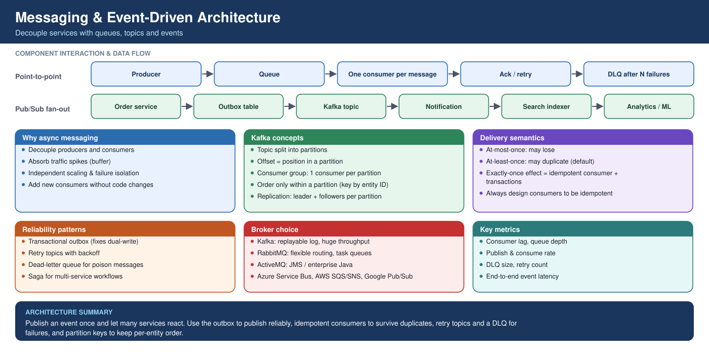


**Reliable messaging: outbox, retry & DLQ** *(generated)* — the dual-write fix and the failure path for bad messages.

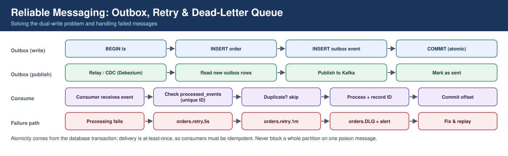


**Message queue** = lets services talk **asynchronously**: the sender doesn't wait for the receiver, so each side can fail, scale and deploy independently.

| Model | Delivery | Example |
|---|---|---|
| Point-to-point (queue) | Each message to **one** consumer | Job/task queues (SQS, RabbitMQ queue) |
| Publish-subscribe (topic) | Each message to **every** subscriber group | Kafka topics, SNS, Google Pub/Sub |

Kafka consumer groups combine both: each group receives every message (pub/sub), and within a group each partition goes to one consumer (queue).

**Fan-out services** (one event, many reactions):

```
                          ┌─► Notification (push / email / SMS)
                          ├─► Search indexer
Event ─► Pub/Sub topic ───┼─► Recommendation & ML processing
                          ├─► Analytics / log processing
                          └─► Payment charge (third-party bank)
```

#### Kafka essentials

| Concept | Meaning |
|---|---|
| Topic / partition | Named append-only log, split into partitions for parallelism |
| Offset | Position of a record in a partition |
| Consumer group | Consumers sharing work; one consumer per partition |
| Ordering | Only within a partition — key by entity ID (`key = orderId`) |
| Replication | Leader + followers; use RF=3, `min.insync.replicas=2`, `acks=all` |

| Delivery | Meaning | How |
|---|---|---|
| At-most-once | May lose, never duplicate | Commit offset before processing |
| At-least-once | Never lose, may duplicate | Process then commit (default) |
| Exactly-once *effect* | Effect happens once | Kafka transactions + **idempotent consumers** |

```java
@KafkaListener(topics = "orders", groupId = "email-service")
@Transactional
public void onOrderPlaced(OrderPlaced event) {
    if (!processedEvents.markProcessedIfNew(event.eventId())) return;   // UNIQUE(event_id) → duplicate, skip
    emailService.sendConfirmation(event);
}
```

**Retries & DLQ:** transient errors → retry topics with backoff; poison messages → DLQ after N attempts, alert, replay after fix.
**Outbox:** write the business row and the event row in **one DB transaction**; a relay or CDC (Debezium) publishes to Kafka. If Kafka is down, events wait safely in the outbox and checkout keeps working.

#### Choosing a broker

| Broker | Strengths | Typical use |
|---|---|---|
| Kafka | Replayable log, very high throughput, retention | Event streaming, analytics, CDC, event sourcing |
| RabbitMQ | Flexible routing, per-message ack, priorities | Task queues, request/reply workflows |
| ActiveMQ (Classic / Artemis) | JMS, enterprise Java | Legacy JMS integrations |
| Azure Service Bus | Sessions (ordered), DLQ, scheduled messages | Azure enterprise workflows |
| AWS SQS / SNS, Google Pub/Sub | Fully managed, simple | Cloud-native queues and fan-out |

**Notification service:** channels (APNs/FCM push, email, SMS, in-app), templates, user preferences and opt-outs, per-user rate limits, dedup with idempotency keys, quiet hours, priority queues, delivery receipts.

**Payment service:** idempotency key on every charge; status state machine (`created → authorized → captured → settled / failed / refunded`); retry transient errors; reconciliation jobs; webhooks for async status; tokenize cards to reduce PCI-DSS scope. Common decline reasons: expired/blocked/invalid card, insufficient balance, provider down.

---

## 13. Distributed Systems Fundamentals

### Overview

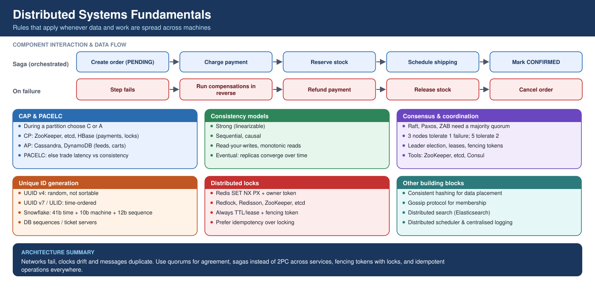


**Consistent hashing** *(generated)* — how keys map to nodes on a ring and why adding a node moves only a few keys.

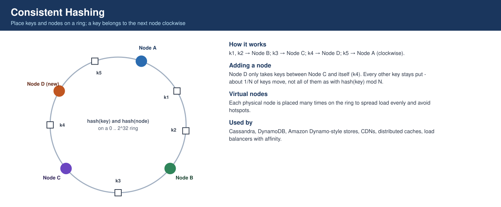


#### CAP and PACELC

During a **network partition** a distributed store must choose **Consistency** (every read sees the latest write) or **Availability** (every request gets a non-error response). Partitions are unavoidable, so the real choice is **CP vs AP**. **PACELC** adds: *Else*, when there is no partition, trade **Latency vs Consistency**.

| Type | In a partition | Examples | Use for |
|---|---|---|---|
| CP | Rejects some requests | ZooKeeper, etcd, HBase, single-primary SQL | Payments, inventory, locks |
| AP | Serves possibly stale data | Cassandra, DynamoDB (eventual reads), DNS | Feeds, likes, carts, catalogues |

Consistency spectrum: **strong (linearizable) → sequential → causal → read-your-writes → eventual**. Conflict resolution for AP systems: last-write-wins, vector clocks, CRDTs, application merge.

#### Consensus & coordination

- **Raft / Paxos / ZAB** agree on a log while a **majority** is alive: 3 nodes tolerate 1 failure, 5 tolerate 2.
- **Leader election** via ZooKeeper, etcd or Consul leases; prevent **split-brain** with quorums, leases and fencing tokens.
- **Gossip protocol:** nodes share membership/state peer-to-peer (Cassandra, Consul).

#### Distributed unique IDs

| Approach | Pros | Cons |
|---|---|---|
| UUID v4 | No coordination | 128-bit, random → poor index locality |
| UUID v7 / ULID | Time-ordered, no coordination | 128-bit |
| DB auto-increment | Simple, ordered | Bottleneck, single point of failure |
| Multi-server step (odd/even) | No single bottleneck | Hard to add servers |
| Ticket server / range allocation | Fast, compact | Extra service |
| **Snowflake** | 64-bit, time-sortable, ~4096 IDs/ms/machine | Needs machine IDs; sensitive to clock going backwards |
| Sonyflake, Baidu UidGenerator | Snowflake variants with different bit splits | Library-specific |

```
Snowflake: | 1 sign bit | 41 bits ms since custom epoch (~69 years) | 10 bits machine ID | 12 bits sequence |
```

#### Distributed locks

| Tool | Notes |
|---|---|
| Redis `SET key token NX PX ttl` | Simple; release only if token matches (Lua script) |
| Redlock / Redisson | Majority of Redis nodes; debated under clock/GC pauses — add fencing tokens for safety |
| ZooKeeper / etcd / Consul | CP, consensus-based; ephemeral nodes / leases |
| Google Chubby | Paxos-based lock service that inspired ZooKeeper |

Concurrency strategies: run serially, serially in batches, **pessimistic** locking (lock then work) or **optimistic** locking (version check at commit). Always use TTL/leases, unique owner tokens and fencing tokens; prefer idempotent operations to locks.

#### Distributed transactions

| Approach | How | Trade-off |
|---|---|---|
| 2PC / XA | Coordinator: prepare → commit | Atomic but blocking and slow; rare across microservices |
| Saga — choreography | Each service emits events; compensations on failure | Loose coupling, harder to trace |
| Saga — orchestration | Central orchestrator drives steps | Clear flow, one place to monitor |
| Outbox + idempotent consumers | Reliable event publishing | Foundation for sagas |

#### Race conditions

| Problem | Fix |
|---|---|
| Lost update (two editors) | Optimistic locking (`@Version`), ETag + `If-Match` |
| Two workers take the same job | `SELECT … FOR UPDATE SKIP LOCKED`, leases, idempotency |
| Check-then-act (`if stock>0 stock--`) | Atomic `UPDATE … WHERE stock > 0` |
| Duplicate client request | Idempotency key |
| Paused process holds expired lock | Fencing tokens |
| Clock skew | Logical clocks, DB sequences, Snowflake safeguards |

#### Other distributed building blocks

| Block | What it is | Options |
|---|---|---|
| **Distributed search** | Index split across nodes, queries run in parallel on shards | Elasticsearch / OpenSearch, Solr, MongoDB Atlas Search, PostgreSQL full-text (smaller scale), managed: Amazon OpenSearch Service, Elastic Cloud, Azure AI Search, Algolia |
| **Distributed logging** | Collect logs from all services into one searchable store | Agents (Fluent Bit, Filebeat) → Kafka (optional) → Elasticsearch / Loki / Splunk; cloud: CloudWatch, Azure Monitor |
| **Distributed task scheduler** | Runs jobs on schedule or on events across a cluster, exactly one runner per job | Kubernetes CronJob, Quartz (clustered), ShedLock, Airflow, Temporal; cloud: Amazon EventBridge Scheduler, Google Cloud Scheduler, Azure Logic Apps / Functions timers |

---
## 14. Scalability

### Overview

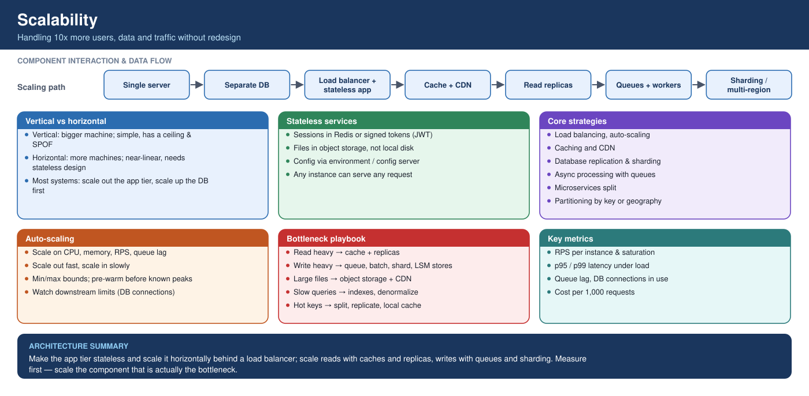


**8 must-know scalability strategies** — stateless services, horizontal scaling, load balancing, auto-scaling, caching, database replication, sharding and async processing.


| | Vertical (scale up) | Horizontal (scale out) |
|---|---|---|
| How | Bigger CPU / RAM | More instances behind a load balancer |
| Pros | Simple, no code change | Near-linear capacity, fault tolerance |
| Cons | Hardware ceiling, downtime, SPOF, expensive | Needs stateless design, distributed complexity |

**Make services stateless:** sessions in Redis or signed tokens; files in object storage; externalised config. *Example:* a cart stored in JVM session memory disappears on redeploy — move it to Redis (`cart:{userId}`).

**Auto-scaling:** scale on CPU, memory, RPS, p95 latency or **queue lag**; scale out fast, in slowly; set min/max; pre-warm before known peaks. Watch downstream limits — more pods means more DB connections.

| Tier | Techniques |
|---|---|
| Static content | CDN, long TTLs, versioned URLs |
| API | Stateless instances, load balancer, auto-scaling |
| Reads | Cache, read replicas, denormalization, CQRS read models |
| Writes | Queue + batch, partitioning, sharding, write-optimised stores (LSM trees: Cassandra) |
| Heavy work | Async workers, message queues |

*Example:* movie site peak 1,150 RPS → 4–6 stateless pods (~300 RPS each with headroom), Redis for hot movies, posters on CDN, auto-scale at 60% CPU or p95 breach.

---

## 15. Reliability, Availability & Fault Tolerance

### Overview

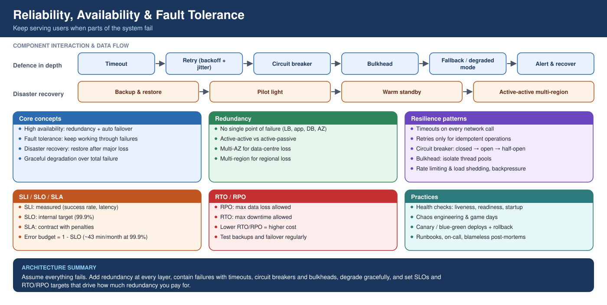


**1. Cheat sheet for designing fault-tolerant systems** — replication, redundancy, load balancing, failover, graceful degradation, monitoring, rate limiting and similar techniques.


**2. Circuit breaker states** *(generated)* — closed → open → half-open → closed.

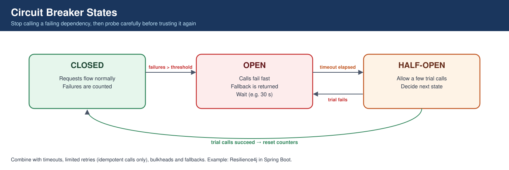


| Term | Meaning |
|---|---|
| High availability | Minimal downtime via redundancy and automatic failover |
| Fault tolerance | Keeps working correctly despite component failure |
| Disaster recovery | Restoring service after a major loss |
| Graceful degradation | Reduced features instead of total failure |
| Health checks | Liveness (restart), readiness (remove from LB), startup |

| Availability | Downtime / year | Downtime / month |
|---|---|---|
| 99% | 3.65 days | ~7.3 h |
| 99.9% | 8.76 h | ~43.8 min |
| 99.99% | 52.6 min | ~4.4 min |
| 99.999% | 5.26 min | ~26 s |

**Composite availability:** components in series multiply (3 × 99.9% ≈ 99.7%); redundant components in parallel improve it (two independent 99.9% replicas ≈ 99.9999%).

| Term | Definition | Example |
|---|---|---|
| SLI | What you measure | % of requests with status < 500 and latency < 200 ms |
| SLO | Internal target | 99.9% over 30 days |
| SLA | Contract with penalties | 99.5% or service credits |
| Error budget | 1 − SLO | ~43 min/month at 99.9% |

**RPO** = max acceptable data loss; **RTO** = max acceptable downtime.

| DR strategy | RTO | RPO | Cost |
|---|---|---|---|
| Backup & restore | Hours | Hours | $ |
| Pilot light | Tens of minutes | Minutes | $$ |
| Warm standby | Minutes | Seconds–minutes | $$$ |
| Active-active multi-region | ~0 | ~0 | $$$$ |

**Resilience patterns:** timeout · retry with exponential backoff + jitter (idempotent calls only) · circuit breaker · bulkhead · fallback · rate limiting / load shedding · backpressure.

**Case: A → B → C, and C takes 30 s.** Without protection B's threads block, then A's — a **cascading failure**, made worse by retry storms. Defence: timeouts that shrink down the chain (C 2 s, B 3 s), at most 1–2 retries, circuit breaker on C, bulkhead for C's calls, fallback response, or make it async (`202 Accepted` + job ID).

```java
@CircuitBreaker(name = "serviceC", fallbackMethod = "fallback")
@Bulkhead(name = "serviceC", type = Bulkhead.Type.THREADPOOL)
@TimeLimiter(name = "serviceC")
@Retry(name = "serviceC")
public CompletableFuture<Result> call(Request r) { return CompletableFuture.supplyAsync(() -> restClient.post(r)); }
```

**Practices:** no single point of failure, tested failover (game days, chaos engineering), safe deployments with fast rollback, runbooks, blameless post-mortems.

---

## 16. Observability & Performance Monitoring

### Overview

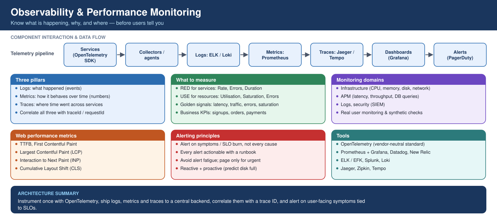


**Website performance metrics** — load time, time to first byte, Core Web Vitals and related user-facing speed metrics.


| Pillar | Answers | Tools |
|---|---|---|
| Logs | What happened? | ELK/EFK, Loki, Splunk |
| Metrics | How is it behaving over time? | Prometheus + Grafana, Datadog, New Relic |
| Traces | Where did the time go across services? | OpenTelemetry, Jaeger, Zipkin, Tempo |
| Alerts | Who must act now? | Alertmanager, PagerDuty, Opsgenie |

**What to measure:** RED for services (Rate, Errors, Duration) · USE for resources (Utilisation, Saturation, Errors) · golden signals (latency, traffic, errors, saturation) · business KPIs.

**Monitoring domains:** infrastructure, APM, logs, security (SIEM, e.g. Wazuh), user experience (real-user monitoring + synthetic checks), business.

**Web performance (Core Web Vitals):** LCP ≤ 2.5 s, INP ≤ 200 ms (replaced FID in 2024), CLS ≤ 0.1; plus TTFB and First Contentful Paint.

**Alerting:** alert on symptoms and SLO burn rate, not every cause; every alert actionable with a runbook; page for urgent, ticket for the rest; combine reactive and proactive (e.g. predict disk full).

```yaml
management:
  endpoints.web.exposure.include: health,prometheus,info
  endpoint.health.probes.enabled: true      # /actuator/health/liveness & /readiness
  tracing.sampling.probability: 0.1          # sample 10% of traces
```

**Debugging "the movie page is slow":** alert (p95 > 500 ms) → dashboard (DB pool 100% since 14:05) → trace (800 ms in `SELECT … FROM reviews`) → logs by `traceId` (new release loads all reviews unpaginated) → fix (paginate + index, or roll back) → verify on the same dashboard.

---

## 17. Security

### Overview

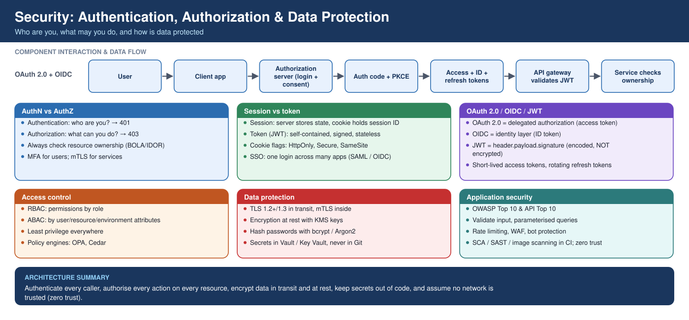


**1. Session, cookie, JWT, token, SSO and OAuth 2.0** — how each mechanism stores and passes identity between browser and server.


**2. Authentication mechanisms — companion chart 1** — second authentication image from your notes.


**3. Authentication mechanisms — companion chart 2** — third authentication image from your notes.


**4. OAuth 2.0 authorization code flow with PKCE** *(generated)*.

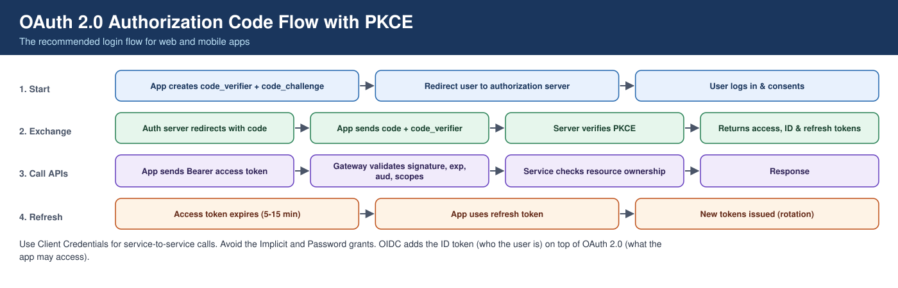


| | Authentication (AuthN) | Authorization (AuthZ) |
|---|---|---|
| Question | Who are you? | What may you do? |
| Mechanisms | Password + MFA, OIDC, API keys, mTLS | RBAC, ABAC, scopes, policies |
| Failure | `401 Unauthorized` | `403 Forbidden` |

> **BOLA / IDOR:** a logged-in user calls `GET /orders/999` that belongs to someone else. Authentication passes — the service must still check ownership.

| Mechanism | How it works | Note |
|---|---|---|
| Session + cookie | Server stores session; cookie holds the session ID | Easy revocation; needs shared session store to scale |
| Token (JWT) | Signed, self-contained claims sent as `Bearer` | Stateless; hard to revoke → keep short-lived |
| SSO | One login for many apps | SAML or OIDC |
| OAuth 2.0 | Delegated **authorization** — access tokens with scopes | Auth code + PKCE (apps), client credentials (service-to-service) |
| OIDC | **Identity** layer on OAuth 2.0 — adds the ID token | "Login with Google/Microsoft" |

**JWT rules:** `header.payload.signature` is **encoded, not encrypted** — no secrets/PII in the payload; verify signature (JWKS), `iss`, `aud`, `exp`; access tokens 5–15 min; rotate refresh tokens; revocation via short TTL, deny-list or introspection. Avoid the Implicit and Password grants.

| | RBAC | ABAC |
|---|---|---|
| Based on | Role (`ADMIN`, `EDITOR`) | Attributes of user, resource, action, environment |
| Example | Admins approve reviews | Editors approve only `PENDING` reviews in their region during business hours |
| Trade-off | Simple; role explosion | Fine-grained; needs a policy engine (OPA, Cedar) |

**Data & secrets:** TLS 1.2+/1.3 everywhere, mTLS between services, HSTS; encryption at rest (KMS) and field-level for sensitive columns; passwords hashed with **bcrypt / Argon2**; secrets in Vault / AWS Secrets Manager / Azure Key Vault — never in Git or images; rotate regularly.

**Application security:** OWASP Top 10 & API Security Top 10 (broken access control, injection, misconfiguration, vulnerable dependencies, SSRF, mass assignment); input validation and parameterised queries; CORS allow-lists, CSRF protection for cookie sessions, security headers (CSP); rate limiting, WAF, bot protection; SAST/SCA/container scanning in CI; audit logs.

**Zero trust:** never trust network location — authenticate and authorize every request (user and service), least privilege, segmentation, short-lived credentials, continuous monitoring.

```java
@Bean
SecurityFilterChain api(HttpSecurity http) throws Exception {
    return http.authorizeHttpRequests(a -> a
                .requestMatchers("/actuator/health/**").permitAll()
                .requestMatchers(HttpMethod.POST, "/reviews/*/approve").hasRole("ADMIN")
                .anyRequest().authenticated())
            .oauth2ResourceServer(o -> o.jwt(Customizer.withDefaults()))
            .build();
}
```

---

## 18. Infrastructure, DevOps & Cost

### Overview

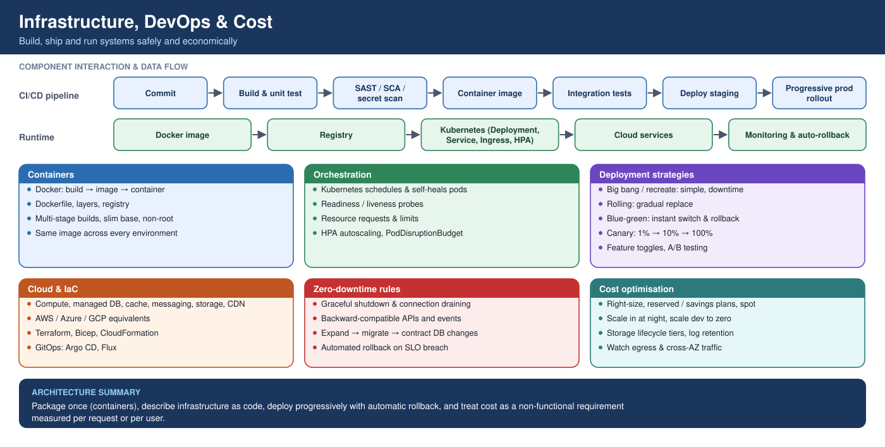


**1. How does Docker work?** — Docker client, daemon, images, containers and registry: build → push → pull → run.


**2. Top 5 most-used deployment strategies** — big bang, rolling, blue-green, canary and feature toggle.


**3. Dev tools** — the tool landscape across coding, version control, CI/CD, containers, cloud, monitoring and collaboration.


**4. Azure services cheat sheet** — Azure services grouped by category (compute, storage, databases, networking, messaging, security, DevOps, AI).


**Docker:** package app + dependencies into an immutable image (multi-stage build, slim JRE, non-root user, Spring Boot layered jars). **Kubernetes:** Deployment, Service, Ingress, ConfigMap/Secret, HPA, PodDisruptionBudget; always set probes and resource requests/limits.

```yaml
readinessProbe: { httpGet: { path: /actuator/health/readiness, port: 8080 }, periodSeconds: 5 }
livenessProbe:  { httpGet: { path: /actuator/health/liveness,  port: 8080 }, periodSeconds: 10 }
resources: { requests: { cpu: "500m", memory: "768Mi" }, limits: { memory: "1Gi" } }
```

| Need | AWS | Azure | GCP |
|---|---|---|---|
| Compute | EC2, ECS/EKS, Lambda | VMs, AKS, Container Apps, Functions | GCE, GKE, Cloud Run |
| Managed SQL / NoSQL | RDS/Aurora, DynamoDB | Azure SQL / PostgreSQL, Cosmos DB | Cloud SQL, Spanner, Firestore |
| Cache | ElastiCache | Azure Managed Redis (successor to Azure Cache for Redis) | Memorystore |
| Messaging | MSK, SQS/SNS, EventBridge | Service Bus, Event Hubs, Event Grid | Pub/Sub |
| Object storage / CDN | S3 / CloudFront | Blob Storage / Front Door | GCS / Cloud CDN |
| Secrets | Secrets Manager, KMS | Key Vault | Secret Manager, KMS |
| IaC | CloudFormation, CDK | Bicep, ARM | Deployment Manager / Terraform |

**CI/CD:** commit → build & unit test → SAST / SCA (e.g. Veracode) / secret scan → image → integration tests → staging → smoke/E2E → progressive rollout → monitor → auto-rollback. GitOps (Argo CD, Flux) keeps Git as the source of truth.

| Strategy | How | Pros | Cons |
|---|---|---|---|
| Big bang / recreate | Replace everything at once | Simple | Downtime, risky |
| Rolling | Replace instances gradually | Default, cheap | Mixed versions; slower rollback |
| Blue-green | Switch traffic to a full new stack | Instant rollback | 2× capacity during cutover |
| Canary | 1% → 10% → 100% while watching metrics | Small blast radius | Needs good metrics & routing |
| Feature toggle / A/B | Deploy dark, enable per cohort | Decouples deploy from release | Flag clean-up |

**Zero-downtime checklist:** readiness probes, graceful shutdown + `preStop` drain, backward-compatible APIs/events, **expand → migrate → contract** database changes.

| Cost lever | Example |
|---|---|
| Right-size | Match instance size to real usage |
| Commitments / spot | Savings plans for steady load; spot for stateless/batch |
| Auto-scale | Scale in at night; dev environments to zero |
| Data tiering | Lifecycle rules to cold storage; log retention limits |
| CDN & caching | Cut origin bandwidth and DB load |
| Network | Watch egress and cross-AZ traffic |
| Observability | Sample traces, drop high-cardinality metrics |

Estimate `unit cost × quantity` per component and track **cost per 1,000 requests** or **per active user**.

---

## 19. Worked Examples

### Overview

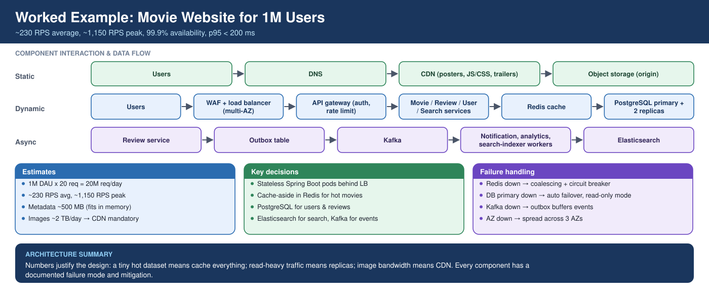


**Failure analysis — what happens when each component fails?**

| Component fails | Impact | Mitigation |
|---|---|---|
| CDN edge | Slower images | Multi-edge / multi-CDN, origin fallback |
| Load balancer node | None if redundant | Active-active, health checks |
| API instance | Some in-flight requests fail | Stateless pods, readiness probes, retries on idempotent calls |
| Redis | DB load jumps | Replicas + failover, coalescing + circuit breaker, local cache fallback |
| PostgreSQL primary | Writes fail during failover | Multi-AZ failover, read-only mode, queue writes, PITR |
| Kafka | Async features delayed | Outbox buffers events, 3-broker multi-AZ cluster |
| Consumer | Lag grows | Group rebalance, auto-scale on lag, idempotent processing |
| Elasticsearch | Search down | Fallback to DB trigram search or cached popular results |
| Auth server | New logins fail | Existing JWTs still valid (JWKS cached), HA deployment |
| Whole AZ | ⅓ capacity lost | Spread across 3 AZs with N+1 capacity |
| Whole region | Outage | DR plan matching RTO/RPO; warm standby or active-active |
| Third party (email, payment) | Feature degraded | Timeouts, circuit breakers, queued retries, idempotent charges |

**Practice: "Design Netflix" with the framework**

1. **Requirements:** browse, play with adaptive quality, personalised home, resume playback, multi-device; 99.99%; global.
2. **APIs:** `GET /v1/titles`, `GET /v1/titles/{id}`, `POST /v1/playback/sessions`, `PUT /v1/profiles/{id}/progress` (idempotent).
3. **Data:** catalogue (document/relational + cache), profiles & billing (relational), viewing history (Cassandra, partitioned by `userId`), video (object storage).
4. **Scale:** CDN appliances inside ISPs (Open Connect), many bitrates/codecs, chunked ABR (HLS/DASH).
5. **Cache:** metadata in EVCache/Redis; CDN for segments and artwork.
6. **Async:** upload → object storage → queue → transcoding workers; playback events → Kafka → analytics & recommendations.
7. **Reliability:** multi-region active-active, fallback to non-personalised rows, chaos testing.
8. **Security:** DRM (Widevine, FairPlay, PlayReady), signed URLs, token auth, device limits.
9. **Observability:** tracing, QoE metrics (rebuffer rate, startup time), SLO dashboards.
10. **Cost:** CDN egress dominates → efficient encoding, edge caching, storage tiering.

---

## 20. Quick Revision

### End-to-end request lifecycle

1. **Client** builds the request (headers, request ID, idempotency key).
2. **DNS** resolves the domain to an IP.
3. **CDN** serves static content or forwards to origin.
4. **Load balancer / API gateway** authenticate, rate-limit, route.
5. **Frontend servers** hold real-time connections and use the **message dispatcher**.
6. **Backend services** run business logic, using **ID generators** and **locks** where needed.
7. **Cache** first; on miss the **database** (replicated, sharded) and re-populate cache.
8. **Media** flows: object storage → queue → workers → processed storage → CDN.
9. **Events** go to **pub/sub** and fan out to notification, search, analytics, ML, payments.
10. **Response** returns with correct status, headers and error format.

### Layer cheat sheet

| Layer | Key concepts | Key metrics |
|---|---|---|
| Client & DNS | Request anatomy, status codes, DNS hierarchy, TTL | Latency, error rate, resolution time |
| API | REST/GraphQL/gRPC, idempotency, pagination, versioning | p95 latency, error rate |
| CDN / edge | Push vs pull, ABR, invalidation, reverse proxy | Hit ratio, origin offload |
| API gateway | AuthN/AuthZ, rate limiting, routing, TLS | 429 count, auth failures |
| Load balancer | L4 vs L7, algorithms, health checks | Active connections, 5xx |
| Real-time | WebSocket, SSE, dispatcher | Concurrent connections |
| Cache | Cache-aside, TTL, LRU, stampede | Hit ratio, evictions |
| Database | ACID/BASE, indexes, replication, sharding | Slow queries, replication lag |
| Messaging | Partitions, consumer groups, outbox, DLQ | Consumer lag, DLQ size |
| Distributed | CAP, consensus, sagas, Snowflake, locks | Retry rate, breaker state |
| Reliability | SLO, RTO/RPO, circuit breaker | Availability, error budget |
| Observability | Logs, metrics, traces | MTTD, MTTR |
| Security | OAuth 2.0/OIDC, JWT, RBAC/ABAC, zero trust | Auth failures, open vulns |
| Infra & cost | Docker, K8s, CI/CD, canary | Deploy frequency, cost per 1K requests |

### Core trade-offs

- Consistency vs availability (CAP); latency vs consistency (PACELC)
- Cache freshness vs speed (TTL length)
- Push vs pull (CDN, notifications)
- Sync vs async (replication, processing)
- Vertical vs horizontal scaling
- Pessimistic vs optimistic concurrency
- Simplicity vs scale — don't shard, cache or split into microservices until numbers justify it

### Problem → section index

| Problem | Section |
|---|---|
| Capacity estimate for 1M users | §2 |
| Duplicate payment on retry | §5, §12 |
| 100,000 users request the same movie / cache stampede | §10 |
| Why PostgreSQL instead of Cassandra? | §11 |
| Last ticket sold twice | §11, §13 |
| Too many DB connections / replica lag | §11 |
| Database or Kafka goes down | §11, §12, §19 |
| Dual write (DB + Kafka) | §12 |
| Transaction across services | §13 |
| A → B → C with C taking 30 s | §15 |
| Scaling the API | §14 |
| RTO / RPO / SLA / SLO | §15 |
| Slow page debugging | §16 |
| AuthN vs AuthZ, OAuth 2.0, JWT | §17 |
| Deploy without downtime | §18 |
| Design Netflix | §19 |

### Glossary

| Term | Meaning |
|---|---|
| ABR | Adaptive bitrate streaming |
| ACID / BASE | Transactional vs eventually consistent models |
| CDN | Content delivery network |
| CQRS | Command Query Responsibility Segregation — separate read and write models |
| DLQ | Dead-letter queue |
| Idempotency | Repeating an operation has the same effect as doing it once |
| LRU / LFU | Least recently / least frequently used |
| PKCE | Proof Key for Code Exchange (protects the OAuth code flow) |
| RPO / RTO | Max data loss / max downtime |
| SPOF | Single point of failure |
| SSE | Server-Sent Events |
| TTL | Time-to-live |
| WAF | Web application firewall |

### Study roadmap

| Phase | Focus | Sections |
|---|---|---|
| 1. Fundamentals (~4 weeks) | Requirements, networking, APIs, LB, caching, databases, CAP | §2–§11, §13 |
| 2. Advanced backend (~4 weeks) | Kafka, gateways, resilience, sagas, observability, security | §12, §13, §15–§17 |
| 3. Infrastructure (ongoing) | Docker, Kubernetes, cloud, CI/CD, cost | §18 |
| 4. Practice (ongoing) | Design real systems end to end; ask "what if it fails?" for every box | §19 |

---

## 21. Corrections & Additions Log

**Headings & placement fixed**

| In your notes | Problem | Now in |
|---|---|---|
| "Session, Cookie, JWT, Token, SSO, OAuth 2.0" under *Data Bases* | Security topic, not databases | §17 Security |
| Azure cheat sheet, Docker, deployment strategies, Nginx under *Cache Systems* | Not caching topics | §18 Infra (Nginx → §6 Edge / reverse proxy) |
| *API & Load Balance* grouping proxy, google.com and website metrics | Mixed topics | §6 Edge, §4 Networking, §16 Observability |
| Part 1 numbering ("9. Monitoring" and "9. Messaging queue", no 8) | Duplicate / missing numbers | Renumbered by topic |
| Handbook "Distributed Coordination Layer" | Mixed ID generation, locks, consensus | §13 Distributed Systems |

**Factual corrections**

| Original statement | Correction |
|---|---|
| "Cloud task schedulers such as Amazon SNS" | SNS is a pub/sub notification service, not a scheduler. Use Amazon EventBridge Scheduler or Google Cloud Scheduler. |
| "Amazon Elasticsearch Service" | Renamed **Amazon OpenSearch Service** (2021). |
| "Google Cloud Search" as a distributed search option for apps | Cloud Search is for enterprise/Workspace content; for application search use Elastic Cloud, OpenSearch, Vertex AI Search, Azure AI Search or Algolia. |
| "MongoDB and Cassandra have built-in search" | MongoDB has Atlas Search; Cassandra only offers limited secondary indexes (SAI) — not full-text search. |
| Cassandra listed as column-oriented storage ("partially") | Cassandra is a **wide-column** store but stores data row-wise per partition; it is not a columnar OLAP engine like ClickHouse/Redshift. |
| Push / Pull listed as *types* of CDN | They are content **population strategies**, not CDN types. |
| "Hybrid queues" as a standard queue type | Not a standard category; the common real-world mix is Kafka consumer groups (pub/sub across groups, queue within a group). |
| "Distributed consensus algorithm" as a main way to generate IDs | Rarely used for IDs (too slow); typical options are UUID/ULID, Snowflake-style, and range/ticket allocation. |
| Rate limiting list missing sliding window counter | Added (§7). |
| Azure Cache for Redis | Microsoft now recommends **Azure Managed Redis** as its successor and has announced retirement of Azure Cache for Redis tiers. |
| Monitoring (FID) | Core Web Vitals now use **INP** instead of FID (since March 2024). |

**Added because they were missing:** latency numbers and powers of two (§2), architecture styles table and microservice patterns (§3), HTTP/2/HTTP/3/TCP/UDP basics (§4), API style comparison (§5), forward vs reverse proxy (§6), consistent hashing diagram (§13), circuit breaker diagram (§15), OAuth PKCE flow (§17), CQRS / event sourcing / sidecar / strangler fig mentions, distributed search/logging/scheduler options (§13), Core Web Vitals targets (§16), and 23 generated diagrams (one overview per major section plus five concept diagrams).
